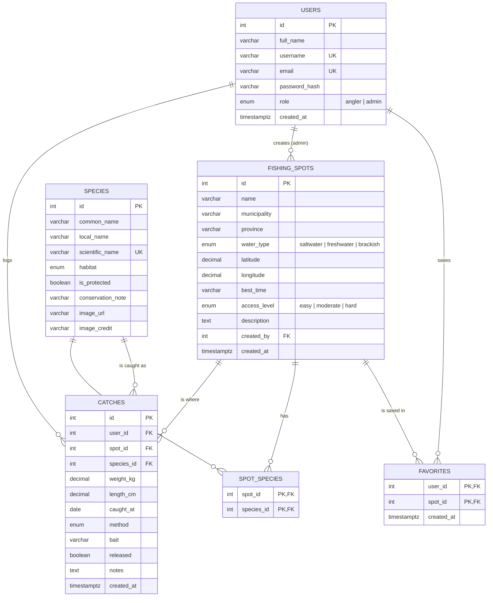

# Pangisda – Database Design (ERD)

DBMS: **PostgreSQL** (relational: the data has clear relationships and needs foreign-key integrity).
The tables are created by `server/database/schema.sql` (run `npm run db:setup`), and the sample rows come from `server/data/db.js`.
Enum columns use PostgreSQL enum types (`user_role`, `water_type`, `access_level`, `fishing_method`).

## Entity-Relationship Diagram

## Relationships

| Relationship | Type | Foreign key | On delete |
|---|---|---|---|
| A user logs many catches | 1 : N | `catches.user_id → users.id` | CASCADE (deleting an account removes its catches) |
| A spot has many catches | 1 : N | `catches.spot_id → fishing_spots.id` | RESTRICT (a spot with catches cannot be deleted) |
| A species appears in many catches | 1 : N | `catches.species_id → species.id` | RESTRICT |
| Spots and species | M : N via `spot_species` | `spot_id`, `species_id` | CASCADE |
| Users save spots | M : N via `favorites` | `user_id`, `spot_id` | CASCADE |
| An admin creates spots | 1 : N | `fishing_spots.created_by → users.id` | SET NULL |

## Normalization (3NF)

- **1NF:** every column holds one value. The species found at a spot are stored as rows in `spot_species`, not as a comma-separated list.
- **2NF:** the junction tables use composite keys, and no column depends on only part of the key.
- **3NF:** no transitive dependencies. A catch stores only `species_id`; the species name lives once in `species`. Location data lives in `fishing_spots`, not in each catch.

## Data dictionary

### users
| Column | Type | Constraints | Description |
|---|---|---|---|
| id | INT | PK, GENERATED BY DEFAULT AS IDENTITY | User ID |
| full_name | VARCHAR(60) | NOT NULL | Display name |
| username | VARCHAR(20) | NOT NULL, UNIQUE | 3–20 chars, `a–z 0–9 _` |
| email | VARCHAR(120) | NOT NULL, UNIQUE | Login email, never shown publicly |
| password_hash | VARCHAR(255) | NOT NULL | bcrypt hash (never plain text) |
| role | user_role ('angler','admin') | NOT NULL, DEFAULT 'angler' | Authorization role |
| created_at | TIMESTAMPTZ | NOT NULL, DEFAULT CURRENT_TIMESTAMP | |

### fishing_spots
| Column | Type | Constraints | Description |
|---|---|---|---|
| id | INT | PK, GENERATED BY DEFAULT AS IDENTITY | |
| name | VARCHAR(80) | NOT NULL | Spot name |
| municipality | VARCHAR(60) | NOT NULL | Town or city |
| province | VARCHAR(60) | NOT NULL, INDEX | Used for filtering |
| water_type | water_type ('saltwater','freshwater','brackish') | NOT NULL, INDEX | |
| latitude | DECIMAL(9,6) | NOT NULL, CHECK 4–22 | |
| longitude | DECIMAL(9,6) | NOT NULL, CHECK 116–127 | |
| best_time | VARCHAR(80) | NULL | e.g. "Early morning, Nov–Mar" |
| access_level | access_level ('easy','moderate','hard') | NOT NULL, DEFAULT 'moderate' | |
| description | TEXT | NOT NULL | At least 20 characters |
| created_by | INT | FK → users.id, NULL | Admin who added the spot |
| created_at | TIMESTAMPTZ | NOT NULL | |

### species
| Column | Type | Constraints | Description |
|---|---|---|---|
| id | INT | PK, GENERATED BY DEFAULT AS IDENTITY | |
| common_name | VARCHAR(80) | NOT NULL | English name |
| local_name | VARCHAR(60) | NOT NULL | Filipino name, e.g. "Lapu-lapu" |
| scientific_name | VARCHAR(80) | NOT NULL, UNIQUE | |
| habitat | water_type ('saltwater','freshwater','brackish') | NOT NULL | |
| is_protected | BOOLEAN | NOT NULL, DEFAULT FALSE | Shows a release reminder in the UI |
| conservation_note | VARCHAR(255) | NULL | |

### spot_species
| Column | Type | Constraints |
|---|---|---|
| spot_id | INT | PK (composite), FK → fishing_spots.id |
| species_id | INT | PK (composite), FK → species.id |

### catches
| Column | Type | Constraints | Description |
|---|---|---|---|
| id | INT | PK, GENERATED BY DEFAULT AS IDENTITY | |
| user_id | INT | FK → users.id, NOT NULL, INDEX | Who logged it |
| spot_id | INT | FK → fishing_spots.id, NOT NULL, INDEX | Where |
| species_id | INT | FK → species.id, NOT NULL | What |
| weight_kg | DECIMAL(6,2) | NOT NULL, CHECK > 0 AND ≤ 500 | |
| length_cm | DECIMAL(5,1) | NULL, CHECK 1–400 | |
| caught_at | DATE | NOT NULL, not in the future | |
| method | fishing_method ('rod_and_reel','handline','fly_fishing','spearfishing','cast_net') | NOT NULL | |
| bait | VARCHAR(60) | NULL | |
| released | BOOLEAN | NOT NULL, DEFAULT FALSE | Catch-and-release |
| notes | VARCHAR(500) | NULL | |
| created_at | TIMESTAMPTZ | NOT NULL | |

### favorites (planned for the Final; saved spots are kept in a browser cookie at midterm)
| Column | Type | Constraints |
|---|---|---|
| user_id | INT | PK (composite), FK → users.id |
| spot_id | INT | PK (composite), FK → fishing_spots.id |
| created_at | TIMESTAMPTZ | NOT NULL |
